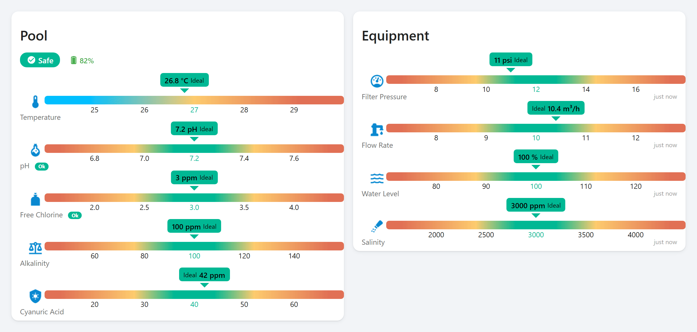

# Pool Monitor Card

[![Release][release-shield]][release-link] [![HACS][hacs-shield]][hacs-link] [![GitHub Activity][commits-shield]][commits-link]

> Keep your swimming pool safe and crystal clear by monitoring up to 28 parameters at a glance, from water chemistry to equipment.



[See the eight ways to configure this card](example/screenshots.md)

> **Upgrading from v1?** The sensor configuration format changed in v2. See the [Migration Guide](docs/MIGRATION.md).

---

## Why this card?

Whether you have a chlorine pool, a saltwater system, or a heated spa, this card gives you an **instant visual overview** of your water quality, right from your Home Assistant dashboard.

Color-coded gradient bars show you at a glance if each parameter is in its ideal range. No need to memorize numbers or look up charts.

Preset ideal ranges for all 28 pool parameters mean you can get started with just an entity ID: the card knows what "good" looks like for pool water.

### What you can do

- Check if the water is safe **before letting the kids swim**
- Monitor pH and ORP trends **after adding chemicals** to see the effect over time
- Track chlorine levels to catch **sanitization drops early**
- Watch filter pressure to know **when to backwash**
- Compare pool vs. spa temperature with **multiple sensors per type**

---

## Sensors (28 presets)

Every sensor comes with **preset ideal ranges**: just point to your entity and the card handles the rest. Override any value to match your setup.

### Essential Water Chemistry

*The core parameters every pool owner should monitor for safe, comfortable swimming.*

    

| Sensor | Key | Unit | Defaults |
|--------|-----|------|:----------------:|
| Temperature | `temperature` | °C | 27 |
| pH | `ph` | pH | 7.2 |
| ORP | `orp` | mV | 700 |
| TDS | `tds` | g/L | 5 |
| Electrical Conductivity | `ec` | µS/cm | 4000 |

### Chemical Balance

*Keeping these balanced prevents algae, scaling, and equipment damage.*

    

| Sensor | Key | Unit | Defaults |
|--------|-----|------|:----------------:|
| Salinity | `salinity` | ppm | 3000 |
| Cyanuric Acid | `cya` | ppm | 40 |
| Calcium | `calcium` | ppm | 300 |
| Phosphate | `phosphate` | ppb | 50 |
| Alkalinity | `alkalinity` | ppm | 100 |

### Treatment & Sanitization

*These tell you if your disinfection system is working properly.*

     

| Sensor | Key | Unit | Defaults |
|--------|-----|------|:----------------:|
| Free Chlorine | `free_chlorine` | ppm | 3 |
| Total Chlorine | `total_chlorine` | ppm | 3 |
| Bromine | `bromine` | ppm | 4 |
| Filter Pressure | `pressure` | psi | 12 |
| Specific Gravity | `specific_gravity` | sg | 1.002 |
| Magnesium | `magnesium` | ppm | 1200 |
| Chlorinator | `chlorinator` | % | 50 |

### Equipment & Maintenance

*Track the health of your pool equipment and supply levels.*

    

| Sensor | Key | Unit | Defaults |
|--------|-----|------|:----------------:|
| Water Level | `water_level` | % | 100 |
| Flow Rate | `flow_rate` | m³/h | 10 |
| UV Radiation | `uv_radiation` | mW/cm² | 4 |
| Product Volume | `product_volume` | L | 20 |
| Product Weight | `product_weight` | kg | 25 |
| Pump Speed | `pump_speed` | % | 50 |
| Light Brightness | `light_brightness` | % | 80 |
| Heat Pump Setpoint | `heat_pump_setpoint` | °C | 28 |
| Humidity | `humidity` | % | 60 |
| Filtration Time | `filtration_time` | h | 8 |
| Pump Energy | `pump_energy` | kWh | 5 |

For detailed explanations of each sensor and why it matters, see [Sensor Details](docs/sensors.md).

Some of the entities this card reads have to be built in Home Assistant first. Ready-made `template` sensors for that are in [Recipes](docs/recipes.md).

---

## Compatible Hardware

Community-tested devices and their supported parameters:

| Brand | Model | Temp | pH | ORP | TDS | HA Support |
|-------|-------|:----:|:--:|:---:|:---:|------------|
| WaterGuru | [WaterGuru SENSE](https://waterguru.com/products/waterguru-sense) | ✔️ | ✔️ | ❌ | ❌ | [Integration](https://github.com/dwradcliffe/home-assistant-waterguru) |
| Bluerriot | [Bluerriot Blue Connect](https://www.blueriiot.com/us-en) | ✔️ | ✔️ | ✔️ | ❌ | [Blog](https://blog.mikejmcguire.com/2021/12/30/home-assistant-add-on-for-blueriiot-blue-connect-plus/) |
| Bluerriot | [Bluerriot Blue Connect Plus Gold](https://www.blueriiot.com/us-en) | ✔️ | ✔️ | ✔️ | ✔️ | [Blog](https://blog.mikejmcguire.com/2021/12/30/home-assistant-add-on-for-blueriiot-blue-connect-plus/) |
| Flipr | [Flipr AnalysR](https://goflipr.com/flipr-analysr-3/) | ✔️ | ✔️ | ✔️ | ❌ | [Component](https://www.home-assistant.io/integrations/flipr/) |
| Inkbird | [Inkbird IBS-P01R](https://pool-thermometer.eu/shop/wifi-swimming-pool-thermometer-bundle-weather-station/?lang=en) | ✔️ | ❌ | ❌ | ❌ | [Component](https://www.home-assistant.io/integrations/inkbird/) |
| iopool | [iopool ECO](https://iopool.com/pages/pool-monitor) | ✔️ | ✔️ | ✔️ | ❌ | [Tuto fr](https://forum.hacf.fr/t/tuto-gestion-de-sa-piscine-avec-sonde-iopool/24292) |
| Ondilo | [Ondilo ICO Pool](https://ondilo.com/en/ico-pool/) | ✔️ | ✔️ | ✔️ | ✔️ | [Component](https://www.home-assistant.io/integrations/ondilo_ico/) |
| Zodiac | [Zodiac iAqualink eXO iQ](https://www.zodiac-poolcare.com/traitement-de-l-eau/electrolyseurs-au-sel/gamme-exo--iq/exo--iq) | ✔️ | ✔️ | ✔️ | ❌ | [Tuto via nodeRED](example/zodiac.md) |
| Tuya | [Tuya BLE-YL01](https://www.zigbee2mqtt.io/devices/BLE-YL01.html) | ✔️ | ✔️ | ✔️ | ✔️ | [Tuto](https://community.home-assistant.io/t/pool-monitoring-device-yieryi-ble-yl01-zigbee-ph-orp-free-chlorine-salinity-etc/659545) |

> ✔️ = supported, ❌ = not supported. [See more hardware](example/hardware.md)

> The columns cover the four parameters most devices share. Several measure more:
> the WaterGuru SENSE reads free chlorine, and its S2 and S3 models also read total
> alkalinity, cyanuric acid and calcium hardness. The card has a preset for each.

> Know a device that works? [Open an issue](https://github.com/wilsto/pool-monitor-card/issues) to add it!

---

## Installation

### HACS (recommended)

1. Open [HACS](https://hacs.xyz/) → **Frontend** → search for **Pool Monitor Card**
2. Install and reload your browser

[](https://my.home-assistant.io/redirect/hacs_repository/?owner=wilsto&repository=pool-monitor-card&category=plugin)

### Manual

1. Download `pool-monitor-card.js` from the [latest release](https://github.com/wilsto/pool-monitor-card/releases)
2. Copy to `config/www/community/pool-monitor-card/`
3. Add resource: `/local/community/pool-monitor-card/pool-monitor-card.js` (type: module)

---

## Quick Start

```yaml
type: custom:pool-monitor-card
title: "My Pool"
sensors:
  temperature:
    entity: sensor.your_temperature_sensor
  ph:
    entity: sensor.your_ph_sensor
  orp:
    entity: sensor.your_orp_sensor
```

That's it! The card uses sensible defaults for everything else.

---

## Configuration

| Option | Type | Default | Description |
|--------|------|---------|-------------|
| `title` | string | - | Card title |
| `sensors` | object | - | Sensor definitions (see below) |
| `status_entity` | string | - | Entity whose state is shown as a badge at the top of the card |
| `battery_entity` | string | - | One battery for the whole device, shown once beside the status |
| `display.compact` | boolean | `false` | Compact display mode |
| `display.show_names` | boolean | `true` | Show sensor names |
| `display.show_icons` | boolean | `true` | Show sensor icons |
| `display.show_units` | boolean | `true` | Show units |
| `display.show_labels` | boolean | `true` | Show range labels |
| `display.gradient` | boolean | `true` | Show gradient bar |
| `display.blink` | boolean | `false` | Blink a reading that falls in the worst band of its scale. Honours `prefers-reduced-motion`, which replaces the blink with a static outline |
| `display.band_fill` | boolean | `false` | Compact mode only: fill the reading row with the colour of its band, so severity reads at a glance. The full layout already colours its value bubble. The cost: the fill hides the threshold marks under the label |
| `display.show_last_updated` | boolean | `false` | Show last update time |
| `display.name_font_size` | string | - | Font size of the sensor name, e.g. `0.8em` |
| `display.name_font_weight` | string | - | Font weight of the sensor name |
| `display.language` | string | `en` | Language code, one of the 17 shipped |
| `colors.*` | string | - | Any colour of the palette, see the Colours section |

### Per-sensor overrides

```yaml
sensors:
  temperature:
    entity: sensor.xxx        # required
    name: Custom Name         # override display name
    unit: "°C"                # override unit
    setpoint: 25              # ideal value
    min: 10                   # number = scale bound, string = tracking entity
    max: 40                   # same
    step: 2                   # threshold step for colors
    icon: mdi:thermometer     # MDI icon
    mode: centric             # centric | heatflow
```

Every option a sensor accepts:

| Option | Type | Description |
|--------|------|-------------|
| `entity` | string | **Required.** The entity to read |
| `attribute` | string | Read this attribute instead of the state. Missing attribute reads as unavailable rather than falling back |
| `name` | string | Override the displayed name |
| `unit` | string | Override the unit |
| `icon` | string | MDI icon, or `hide` to show none |
| `image_url` | string | Image instead of an icon |
| `setpoint` | number | The ideal value the bands are built around |
| `step` | number | Width of one band, so how tolerant the scale is |
| `step_low` | number | Band width below the setpoint, when it differs |
| `step_high` | number | Band width above the setpoint |
| `min_limit` | number | Lowest value the bar will show |
| `limits` | number[] | Four explicit boundaries. Replaces `setpoint` and `step`, which are then ignored |
| `direction` | string | `lower_is_better` (default) or `higher_is_better`, with `limits` |
| `mode` | string | `centric` or `heatflow`, when no preset decides it |
| `min` | number | string | Number = scale bound. String = entity placing a marker |
| `max` | number | string | Same |
| `status_entity` | string | A status for this measurement alone, shown as a badge beside it |
| `battery_entity` | string | Battery of this sensor. For one device with one battery, use the card-level option instead |
| `availability_entity` | string | Greys the row out when this entity is off |
| `setpoint_entity` | string | Reads the setpoint from an entity rather than a fixed number |
| `min_limit_entity` | string | Same, for `min_limit` |
| `derivative_entity` | string | A Home Assistant `derivative` helper watching this measurement. Its sign gives the direction of the trend chevron, its magnitude the number of chevrons |
| `derivative_scale` | number | How much slope is worth one chevron, and the floor below which none shows. Defaults to `0.1` |
| `last_updated_entity` | string | Where the measurement time comes from |
| `last_updated_attribute` | string | Attribute holding that time, e.g. PoolLab `measured_at` |

`min` and `max` accept two forms and the type decides: a **number** is a bound
of the visible scale, a **string** is an entity whose value places a tracking
marker on the bar.

Without them, the bar spans `setpoint ± 3 × step`, and the coloured zones
change every `step`. So `step` is what widens or narrows the green zone:
a larger `step` is more tolerant, a smaller one more strict.

### Every sensor needs a scale

A reading is only worth showing if it can be compared to something. A sensor
that carries no reference is **refused**: the card shows a warning in its place
and draws no bar for it, while the rest of the card keeps working.

A sensor has a scale when it has either of these:

- four explicit `limits`, or
- a `setpoint`, written here, read from `setpoint_entity`, or inherited from
  the preset.

The two near misses are worth naming, because both look like a scale:

- **`min` and `max` are not one.** They size the bar. A sensor with
  `min: 0, max: 100` and nothing else draws a full-width bar with the cursor in
  the right place, and still has nothing to judge the reading against.
- **`step` alone is not one either.** It is the width of a band, with no value
  to build the bands around.

Every preset on this card already carries a scale, so this only bites on a
sensor key the card does not know, or on a preset whose `setpoint` you
replaced with nothing.

### Quantities whose ideal is at one end

`centric` and `heatflow` both place the ideal value in the middle. For PM2.5,
where 0 is best, or ORP, where higher is better, give the four class
boundaries explicitly and say which way the scale reads:

```yaml
sensors:
  pm25:
    entity: sensor.pm25
    min: 0
    max: 20
    limits: [2, 5, 10, 15]    # four boundaries, replaces setpoint/step
    # direction: lower_is_better (default) | higher_is_better
```

### Several probes for the same measurement

A probe at each end of the pool, one in the spa, a spare in the skimmer:
any sensor key accepts a **list** instead of a single block. Each entry
gets its own bar. Nothing to install, nothing to enable, it has always
worked.

```yaml
type: custom:pool-monitor-card
title: "My Pool"
sensors:
  temperature:
    - entity: sensor.temperature_shallow_end
      name: Shallow end
    - entity: sensor.temperature_deep_end
      name: Deep end
```

- **Each entry takes the full set of options above.** `min`, `max`, `setpoint`, `icon`, `status_entity`, `battery_entity`, all of them, and they are independent.
- **The preset still applies to every entry.** `temperature` keeps its ideal range, its unit and its icon unless that entry overrides them.
- **Give each one a `name`.** Without it every entry falls back to the same default label, and the bars become impossible to tell apart.
- **`entity` is required on every entry.** A missing one stops the card with `Missing entity for temperature[1]`, the number being the position in the list counting from zero.

> **The visual editor edits these, but does not create them.** Once a preset is configured it leaves the *Add sensor* list, so the second entry is added in YAML. After that the editor shows both as *#1* and *#2*, each expandable and deletable on its own.

### Styling

The card renders a standard `ha-card`, so it responds to your Home Assistant
theme and to [card-mod](https://github.com/thomasloven/lovelace-card-mod) like
any other card.

> **Install card-mod first, it does not come with Home Assistant.**
> It is a separate frontend component, not part of this card and not
> bundled with it. Until it is installed a `card_mod:` block is simply
> ignored: the styles do nothing and no error says why.
>
> It is in the HACS default store. HACS → search **card-mod** → install →
> reload your browser. Everything in this section assumes it is there;
> installation details live in the
> [card-mod repository](https://github.com/thomasloven/lovelace-card-mod).

**Transparent, borderless:**

```yaml
type: custom:pool-monitor-card
card_mod:
  style: |
    ha-card {
      background: transparent;
      box-shadow: none;
      border: none;
    }
sensors: ...
```

**Sizes, colours, spacing**: target the classes below:

```yaml
card_mod:
  style: |
    .pool-monitor-title { font-size: 2rem !important; }
    .entity-icon { color: var(--error-color); }
    .gauge-scale { font-size: 1.1em !important; }
```

> **Why some rules need `!important`.** The card ships its styles as an
> adopted stylesheet, and those win over an injected one at equal
> specificity. So a property the card already sets (a font size, a bar
> height) needs `!important` or a more specific selector such as
> `h1.pool-monitor-title`. A property the card does **not** set, like the
> icon colour above, applies with no ceremony. Styling `ha-card` itself
> also works plainly: that rule crosses a shadow boundary, where the
> outer stylesheet wins.

| Class | What it is |
| --- | --- |
| `.pool-monitor-title` | Card title |
| `.entity-icon` / `.entity-icon-compact` | Sensor icon, normal and compact modes |
| `.gauge-scale` | Row of numbers under the bar |
| `.grid-item-text-box` | Sensor name and value |
| `.status-badge` | Status badge |
| `.battery-indicator` | Battery level indicator |
| `.progress-bar-child` | The coloured bar itself |
| `.cursor` / `.cursor-text` | Current-value marker and its label |

> Marker positions and colours are computed per reading and set inline, so
> they follow the sensor value rather than a stylesheet. Everything listed
> above is static and can be overridden.

### Colours

The bands are painted from an eight-colour palette. Override any of them
under `colors:`, in YAML or in the visual editor. No card-mod involved.

```yaml
colors:
  normal: "#00b894"
  warn: "#e17055"
```

| Key | Default | What it paints |
| --- | --- | --- |
| `colors.low` | `#fdcb6e` | One band out from the ideal, on either side of a centric scale |
| `colors.warn` | `#e17055` | The outer band, and the hot end of a `heatflow` scale |
| `colors.normal` | `#00b894` | The ideal band, in every mode |
| `colors.fair` | `#7ec181` | Second band of a `limits` scale, still acceptable but no longer ideal |
| `colors.cool` | `#00BFFF` | The cold end of a `heatflow` scale, and the low end of its gradient bar |
| `colors.hazardous` | `#8e44ad` | Worst band of a `limits` scale |
| `colors.marker` | `#000000` | The current-value cursor |
| `colors.hi_low` | `#00000099` | The `min` and `max` tracking ticks |

> `fair` and `hazardous` only appear on a scale built with `limits`, where
> the reading runs from good to bad in one direction. A centric scale never
> reaches them.

### Languages

17 languages supported: Català, Čeština, Dansk, Deutsch, English, Español, Français, עברית, Magyar, Italiano, Nederlands, Português, Português (Brasil), Română, Русский, Slovenčina, Svenska.

Set one with `display.language`, or pick it in the visual editor.

---

## Troubleshooting

**The card does not appear, or Home Assistant says `Custom element doesn't exist`.**
Reload the page while bypassing the cache (Ctrl+Shift+R, or Cmd+Shift+R on a Mac). In the companion app, clear the frontend cache in its settings. Then check that the resource is listed under Settings → Dashboards → Resources: HACS adds it on install.

**A warning is shown where a reading should be.** The card says what is wrong in your language. In English:

- *This card has no sensor to show. Add at least one under `sensors` in the card configuration.* The card has no sensor yet: see [Quick Start](#quick-start).
- *Entity `<entity>` could not be found. Check that the entity ID is spelled the way Home Assistant has it, and that the integration providing it is loaded.* Compare the ID with Settings → Devices & services → Entities.
- *Sensor `<name>` is not one this card knows. Pick a sensor from the list in the visual editor, or write its key exactly as the documentation spells it.* The key under `sensors:` is misspelled.
- *Sensor `<name>` has no scale, so no reading can be judged against anything. Give it four `limits`, or a `setpoint` with a `step`. Note that `min` and `max` only size the bar, they are not a scale.* See [Every sensor needs a scale](#every-sensor-needs-a-scale).
- *No data for this sensor.* The entity has no readable value. Look at its state in Developer Tools → States: `unknown` or `unavailable` comes from the integration, not from the card.

**A reading I consider fine is painted orange or red.**
The bands come from a `setpoint` with a `step`, or from four `limits`. Write your own for that sensor, as shown in [Per-sensor overrides](#per-sensor-overrides). `min` and `max` change the size of the bar, not the bands.

**My sensor reports in Fahrenheit.**
Nothing to do. Since the October 2026 release, a preset written in °C follows a sensor that reports in °F, and the reading keeps the number Home Assistant shows. A `setpoint` or `step` you write yourself is read in your sensor's unit.

**Too many or too few decimals.**
The card uses the display precision Home Assistant has for the entity. Change it in the entity's settings, under Display precision.

**The value I want is an attribute, not the state.**
Add `attribute: <name>` to that sensor: see [Per-sensor overrides](#per-sensor-overrides).

**The badge at the top of the screenshots.**
It shows the state of any entity you point `status_entity` at, at the card level or for one sensor: see [Configuration](#configuration).

**`card_mod` styles have no effect.**
card-mod is a separate card and must be installed first: see [Styling](#styling).

**Will my device work?**
Any device that gives Home Assistant a numeric sensor works. Some are listed under [Compatible Hardware](#compatible-hardware).

Still stuck? [Open an issue](https://github.com/wilsto/pool-monitor-card/issues) with your card YAML, your Home Assistant version and a screenshot.

---

## Support

[](https://bmc.link/wilsto)

---

## Acknowledgments

This card wouldn't be what it is today without our amazing contributors!

- [Gregtakacs](https://github.com/gregtakacs): Min/Max Tickers and custom bar colors
- [Djgel](https://github.com/djgel): Specific gravity measurements
- [JDeighty4](https://github.com/JDeighty4): Magnesium sensor support
- [hlaffez](https://github.com/hlaffez): Tuya BLE-YL01 compatibility
- [DAVIZINH0](https://github.com/DAVIZINH0): Bluerriot compatibility information
- [Sangoku](https://github.com/Sangoku): Bromine sensor support
- [cloudbr34k84](https://github.com/cloudbr34k84): The Tuya multi-parameter tester and the Jaalee JHT-P, and how each one reaches Home Assistant, which opened the hardware page ([#5](https://github.com/wilsto/pool-monitor-card/issues/5))
- [soupman98](https://github.com/soupman98): Hayward OmniLogic configuration, which produced the `chlorinator`, `pump_speed`, `light_brightness` and `heat_pump_setpoint` presets ([#58](https://github.com/wilsto/pool-monitor-card/issues/58))
- [Millhouse1981](https://github.com/Millhouse1981): Spotted that the published v1.5.0 bundle was still the 1.4.0 build, corrected in v1.5.1 ([#15](https://github.com/wilsto/pool-monitor-card/issues/15))
- [smashtup](https://github.com/smashtup): Display precision fix (Entity Registry)
- [arketec](https://github.com/arketec): Design of the derivative-driven trend indicators (chevrons), from his fork ([commit 4730f95](https://github.com/arketec/pool-monitor-card/commit/4730f95))
- [sierramike](https://github.com/sierramike): Home Assistant rendering compliance: the `ha-card` wrapper and the card picker registration ([pool-monitor-card#67](https://github.com/wilsto/pool-monitor-card/pull/67))
- [daveewall](https://github.com/daveewall): WaterGuru SENSE report that specified the card-level `battery_entity` and the per-sensor `status_entity` ([pool-monitor-card#77](https://github.com/wilsto/pool-monitor-card/issues/77))
- [ahuffman](https://github.com/ahuffman): Proposal to list several entities under one sensor type, which became the v2 configuration format ([pool-monitor-card#25](https://github.com/wilsto/pool-monitor-card/issues/25))
- [woopstar](https://github.com/woopstar): Showed that Danish plurals differ from one time unit to the next, which produced the `time_plural` block every locale carries ([pool-monitor-card#53](https://github.com/wilsto/pool-monitor-card/issues/53))
- [rocknrolla85](https://github.com/rocknrolla85): Named what both scale modes got wrong for ORP and TDS, which produced `direction: lower_is_better / higher_is_better` ([pool-monitor-card#85](https://github.com/wilsto/pool-monitor-card/issues/85))
- [Kraut-bob](https://github.com/Kraut-bob): Described the third scale mode, for readings whose best value is zero ([air-quality-card#2](https://github.com/wilsto/air-quality-card/issues/2))
- [Seebaer1976](https://github.com/seebaer1976): German translation
- [Splitti](https://github.com/splitti): German translation
- [Djgel](https://github.com/djgel): Portuguese translation
- [CosminFRC](https://github.com/CosminFRC): Romanian translation
- [Misa1515](https://github.com/misa1515): Slovak translation
- [ViPeR5000](https://github.com/ViPeR5000): Portuguese translation
- [Yehuda](https://github.com/Yehuda): Hebrew translation
- [mmiguel4](https://github.com/mmiguel4): Portuguese translation
- [MrSnakeSPb](https://github.com/MrSnakeSPb): Russian translation
- [taczirjak](https://github.com/taczirjak): Hungarian translation
- [KIDNORswe](https://github.com/KIDNORswe): Swedish translation
- [FejbyK](https://github.com/FejbyK): Czech translation
- [XattSPT](https://github.com/XattSPT): Catalan translation
- [Andreasb95](https://github.com/Andreasb95): Danish translation

## Monitor Cards Family

This card is part of the **monitor-cards** family: same rendering engine, same features, different presets:

| Card | For | Sensors |
|------|-----|---------|
| [Pool Monitor Card](https://github.com/wilsto/pool-monitor-card) | Pool & spa owners | 28 presets ← *you are here* |
| [Aquarium Monitor Card](https://github.com/wilsto/aquarium-monitor-card) | Freshwater & saltwater aquarium keepers | 15 presets |
| [Air Monitor Card](https://github.com/wilsto/air-quality-card) | Homeowners concerned about indoor air quality | 15 presets |
| [Sensor Monitor Card](https://github.com/wilsto/sensor-monitor-card) | Home Assistant power users | unlimited (custom) |

<!-- Badges -->
[release-shield]: https://img.shields.io/github/v/release/wilsto/pool-monitor-card?style=flat-square
[release-link]: https://github.com/wilsto/pool-monitor-card/releases/latest
[hacs-shield]: https://img.shields.io/badge/HACS-Default-orange.svg?style=flat-square
[hacs-link]: https://hacs.xyz/
[commits-shield]: https://img.shields.io/github/commit-activity/y/wilsto/pool-monitor-card?style=flat-square
[commits-link]: https://github.com/wilsto/pool-monitor-card/commits/main